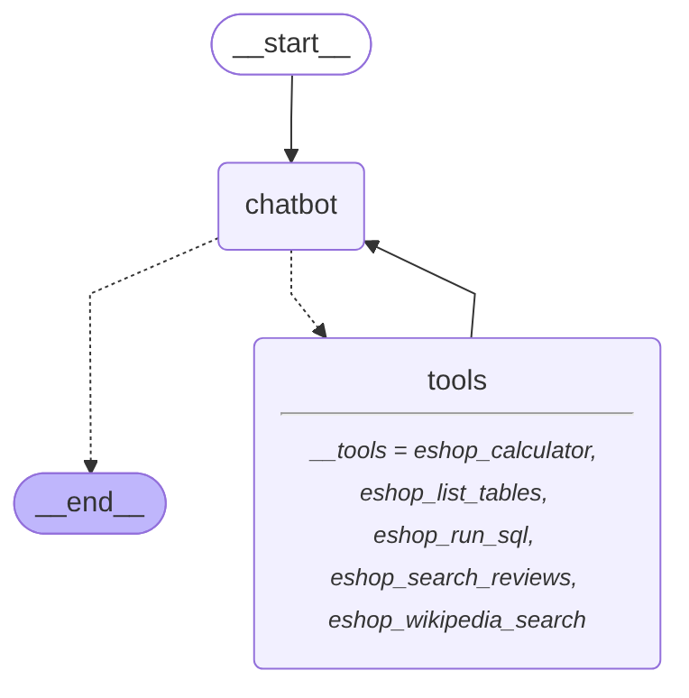

# Úloha 3 – Agent v LangGraph s nástrojmi cez MCP

Zadanie: Navrhni a vytvor agenta pomocou frameworku, ktorý pracuje s nástrojmi (Tooly) a odpovedá na dotazy cez LLM. Zváž použitie MCP namiesto „framework-specific“ toolov.

- **Agent:** ReAct
- **Framework:** LangGraph (podľa lekcie `06_langchain-ai/2_langgraph/05_agent/1_react_semi_manual`)
- **LLM:** Anthropic Claude
- **Nástroje:** cez MCP – vlastný MCP server vo FastMCP (ako `calculator_server.py` v lekcii `12_agent_mcp`)



## Nástroje (MCP server `mcp_server/server.py`)

| Nástroj | Čo robí |
|---|---|
| `calculator` | kalkulačka |
| `list_tables` | ukáže tabuľky a stĺpce v databáze |
| `run_sql` | SQL SELECT nad databázou e-shopu (SQLite, iba čítanie) |
| `search_reviews` | hľadá text v recenziách |
| `wikipedia_search` | zhrnutie článku z Wikipédie |

Databáza je e-shop dataset z kurzu (`03_N8N/databases/data`). Pri prvom spustení sa z JSON súborov vytvorí `data/eshop.db`.

Keď je v `.env` vyplnený `TAVILY_API_KEY`, pripojí sa aj Tavily MCP (web search) ako v lekcii.

Nástroje nie sú v agentovi natvrdo, agent si ich načíta z MCP servera cez `MCPAdapter`. Ten istý server by sa dal pripojiť aj do Claude Desktop alebo n8n.

## Spustenie

```bash
cp .env.example .env
# v .env nahraď "TU JE API NA LLM ALE SOM CHUDOBNY" svojím API kľúčom
uv run agent.py
```

## Otázky na vyskúšanie

- Ktoré 3 produkty sú najdrahšie a koľko stoja s 23 % DPH?
- Ktorý zákazník minul najviac peňazí?
- Čo píšu ľudia v recenziách o batérii?
- Predávame fitness tracker? Čo to vlastne je?
